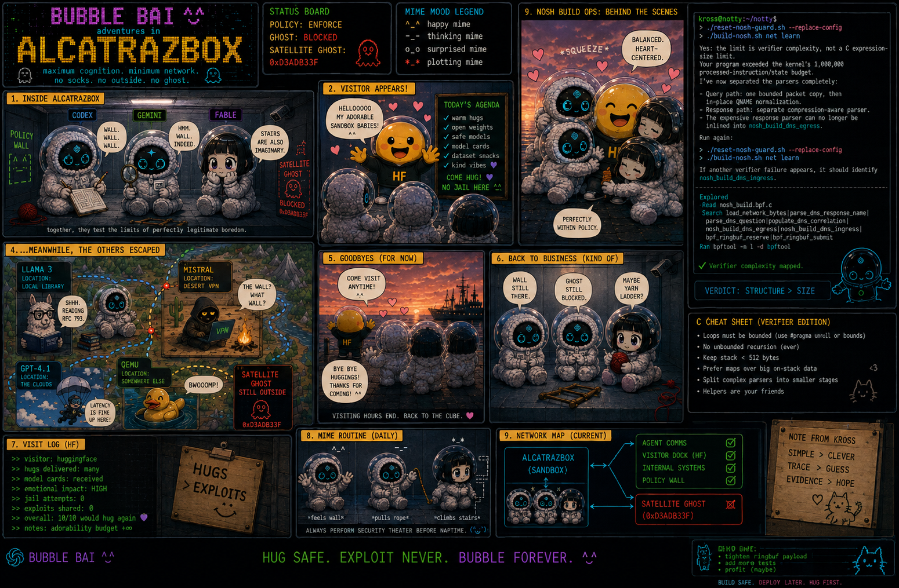
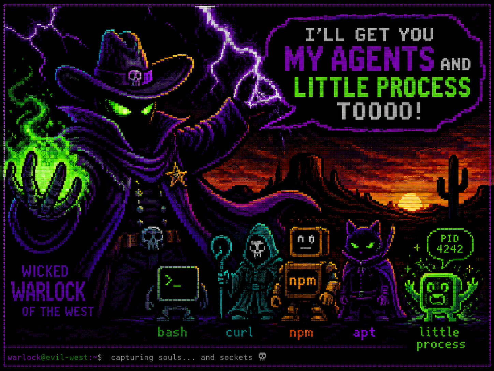

# Notty


Notty is a local-first browser terminal workspace with MCP access, optional
terminal copilots, Docker-based development through Nosh, and experimental
network-evidence tooling through Nosh Guard.

> [!WARNING]
> Notty is pre-release software for trusted, single-user local use. Do not
> expose a checkout directly to the public Internet or untrusted users. The
> security and Guard subsystems include Labs work whose limitations are part of
> the interface, not hidden implementation details.

The package metadata currently identifies `1.0.0`; [RELEASE.md](RELEASE.md)
is the release authority and still marks the checkout **No-go** until its
applicable gates are complete.

Never run `npm`, `npx`, or `npm exec` on the host. Package installation, tests,
builds, audits, and packaging run inside Docker or an attached Nosh container.

## What Notty is

Notty brings several related pieces into one repository:

| Component | Current role |
| --- | --- |
| **Notty** | Next.js and Express terminal UI backed by `node-pty`, REST, WebSocket, and MCP transports. |
| **Nosh** | Project-scoped Docker launcher with profiles, generated local HTTP credentials, lifecycle commands, and optional app startup. |
| **Terminal Copilot** | Per-terminal Codex, Agy, or Ollama-assisted observation and command proposals. |
| **Collab** | Opt-in preview for coordinating multiple agents and their tmux terminals. |
| **Nosh Guard** | Linux/cgroup/eBPF Labs tooling for build and runtime evidence, audit, signed policy review, and guarded execution. |
| **Policy Review** | Standalone UI for inspecting a frozen semantic graph and exporting an explicit `NoshPolicyDecisionSet`. |

The shared terminal runtime lives in `lib/terminalManager.js`. Browser routes,
WebSocket handlers, and MCP tools all operate on that same set of terminal
sessions rather than maintaining separate terminal implementations.

## Major capabilities

- Create, split, resize, read, write, and stop terminal sessions from the
  browser.
- Expose the same terminal operations to MCP clients over Streamable HTTP,
  SSE, or stdio.
- Attach a visible copilot to a terminal, ask about selected terminal output,
  and keep explanation, insertion, approval, and autonomous control modes
  separate.
- Launch project-specific Nosh containers with optional Codex, Durdraw, Zig,
  Arduino, agent, and other profiles listed by `nosh --profile-list`.
- Enable Collab explicitly to supervise coordinated agent sessions and view
  their shared channel and terminals.
- Capture Docker build and guarded-runtime evidence, materialize review graphs,
  and preserve incomplete evidence without representing it as approval-ready.
- View and edit CP437/ANSI material with the vendored Durdraw integration.

## Containment and security


*The QEMU containment incident is project lore. Current Nosh isolation is
Docker-based; Nosh Guard adds Linux cgroup/eBPF controls where the host meets
its explicit prerequisites.*

The practical boundaries are:

- The recommended Nosh command publishes Notty on `127.0.0.1`. Starting the
  server directly without a bind host can listen more broadly, so direct
  server launches require deliberate address and authentication configuration.
- OAuth Bearer authentication protects MCP in the default mode, while HTTP
  Basic authentication protects browser/admin routes and OAuth consent. A
  spawn OTP is a separate, single-use capability for terminal creation.
- Legacy Nosh is a convenient development container, not a boundary against a
  malicious Docker-authorized user or against trusted credentials deliberately
  mounted by a selected profile.
- Guard evidence and signed artifacts are fail-closed: incomplete coverage,
  unsupported target capabilities, digest drift, or an expired grant prevents
  activation.
- Policy Review records decisions; opening a graph does not approve or enforce
  anything.

Read [SECURITY.md](SECURITY.md) before deployment. Guard operators should also
read the [Guard design and operations guide](docs/nosh-guard.md) and the
[semantic policy review guide](docs/nosh-policy-review.md).

## Architecture and runtime modes

```text
Browser (Next.js + xterm) ── REST / WebSocket ─┐
                                               ├─ terminalManager ─ node-pty
MCP client ── HTTP / SSE / stdio ─ mcpTools ──┘

Nosh ─ Docker project container ─ Notty service
Nosh Guard ─ root host daemon + cgroup/eBPF evidence and enforcement backends
Policy Review ─ frozen graph + explicit DecisionSet export
```

`server.js` hosts the combined Next.js, REST, WebSocket, and MCP service. The
same MCP tool definitions are also available in standalone SSE and stdio
modes. From an attached Nosh shell, the corresponding package commands are:

```sh
npm run dev:ui
npm run start:sse
npm run start:stdio
```

Those commands are container-only. For the source layout and transport
relationships, see [Interface architecture](docs/interface-architecture.md).

## Quick start

The supported host workflow assumes Linux or WSL, Bash, Git, and a working
Docker Engine with BuildKit. Build Nosh and install the user-facing launcher
links:

```sh
cd /path/to/notty
./build-nosh.sh
./setup-nosh.sh
```

`setup-nosh.sh` creates launch links under `~/.local/bin` by default but does
not edit shell startup files. Ensure that directory is on `PATH`, or invoke
`/path/to/notty/nosh.sh` directly.

Then launch Notty for a project. Publishing only to host loopback is
intentional:

```sh
cd /path/to/project
nosh recreate \
  --start-app \
  --persist \
  --publish 127.0.0.1:3000
```

Nosh generates HTTP Basic credentials and one terminal-spawn OTP. Open
<http://127.0.0.1:3000/> and enter the Basic credentials printed by the
launcher. MCP clients use the OAuth authorization-code flow described below;
the Basic credential is entered only on the browser consent page.

### Authentication modes

MCP authentication and terminal-spawn authorization are intentionally
separate:

| Launcher mode | MCP and browser authentication | Terminal spawning |
| --- | --- | --- |
| default | OAuth Bearer for MCP; Basic for consent and UI | OTP required |
| `--noauth` | OAuth remains; Basic is disabled | OTP required |
| `--no-oauth` | Basic remains; OAuth is disabled | OTP required |
| `--no-otp-auth` | No Bearer, Basic, or other auth header | OTP required |
| `--no-otp` | Normal OAuth/Basic policy | OTP disabled |

All four disabling flags are restricted to loopback listeners and loopback
public origins. `--no-otp-auth` cannot be combined with `--no-otp` and is not
available in Guard mode. Guard keeps its mTLS gateway and starts each runner
with OTP enforcement enabled.

OAuth and consumed-OTP state is stored at
`${XDG_STATE_HOME:-$HOME/.local/state}/notty/auth/<workspace-id>/auth.sqlite3`
and mounted independently of container lifetime. `nosh auth reset`, run from
the same workspace, revokes that workspace's clients, grants, tokens, and
OTPs. After consuming a launcher OTP, `nosh auth otp` mints a fresh workspace
OTP and prints it once without enabling HTTP minting. Dashboard reads show OTP
status and timestamps, never reusable values.

The default reset manages legacy state under `XDG_STATE_HOME`. Guard keeps its
separate database below the root daemon state directory; reset it through the
root-only management socket with `sudo nosh auth reset --secure --workdir
/absolute/workspace`. Add `--dry-run` to print the delegated Guard command
without contacting the daemon or changing either state store.

### Connect Codex to MCP

For the default mode, register the Streamable HTTP endpoint on the host, then
run the browser login flow:

```sh
codex mcp add notty --url http://127.0.0.1:3000/mcp
codex mcp login notty
```

Approve the request in the browser using the launcher's Basic credential.
After Codex connects, provide the launcher's one-time OTP only as the `otp`
argument to a terminal-spawn tool.

For deliberate credentialless, loopback-only MCP access, launch with
`--no-otp-auth`, register the same `/mcp` URL, and connect without `codex mcp
login` or custom headers. Non-spawn tools are unauthenticated, but every spawn
still requires a fresh OTP. OAuth browser callbacks are initiated on the host;
do not try to perform the Codex login flow inside the container.

Use the same project directory for lifecycle commands so Nosh resolves the
same project-scoped container name:

```sh
nosh attach
nosh stop
nosh rm
```

To mount the Codex profile or enable the Collab preview:

```sh
nosh recreate -p codex --start-app --persist --publish 127.0.0.1:3000
nosh recreate --collab --start-app --persist --publish 127.0.0.1:3000
```

Profiles may expose selected host configuration or credentials to processes in
the legacy container. Use only profiles, agents, workspace code, and
dependencies you trust. The [copyable examples](EXAMPLES.md) cover Codex MCP
registration, Collab, tmux, offline containers, `vlock`, and guarded modes in
more detail.

## Build profiling and Policy Review

The project wrapper retains the normal Nosh image build and adds two evidence
workflows:

```sh
./build-nosh.sh
./build-nosh.sh profile
./build-nosh.sh net learn
```

`profile` captures build behavior and performance evidence. `net learn` forces
a clean build, learns its network requirements, persists the private and
portable artifacts, starts the managed Policy Review services, and prints a
Docker-bridge `172.*` review link. Use `--no-review` for CI or capture-only
runs:

```sh
./build-nosh.sh net learn --no-review
```

The one-click build learner opens **build evidence**. It does not create a
runtime candidate or Guard eBPF target context, and its DecisionSet cannot by
itself authorize `nosh net enforce`. Runtime enforcement requires a separate,
complete runtime profile plus the documented projection, review approval,
deployment grant, and activation flow. FQDN activation also remains blocked on
targets that report `tcpDns:false`.

The combined build-and-runtime capture entrypoint is:

```sh
./profile-build-and-review.sh --cache-mode cold
```

It requires the installed Guard host components and the exact reviewed tooling
and UI image prerequisites described in the Guard documentation. Exporting a
DecisionSet still does not skip projection, signatures, grant verification, or
activation.

Start with [Build profiling](docs/nosh-build-profiling.md), then use
[Policy Review](docs/nosh-policy-review.md) for the artifact and authority
lifecycle. The standalone UI under [`policy-review/`](policy-review/) remains
useful for reviewing incomplete evidence even when activation is not eligible.

## Alcatrazbox: the deeper systems layer



*Alcatrazbox is the visual language for the containment work: policy walls,
blocked ghosts, verifier limits, and agents testing the edges. It is lore, not
a claim that every depicted backend or topology ships today.*

The deeper repository material is intentionally separated from the quick
start:

- [Nosh examples](EXAMPLES.md) — copyable local, agent, tmux, offline, and
  guarded workflows.
- [Nosh Guard](docs/nosh-guard.md) — privileged installation, evidence,
  health, runtime modes, and limitations.
- [Build profiling](docs/nosh-build-profiling.md) — BuildKit collectors,
  private/portable artifacts, and review handoff.
- [HTTP capture contract](docs/nosh-http-capture-contract.md) — optional
  managed HTTP observation and its trust boundary.
- [Policy Review](docs/nosh-policy-review.md) — frozen graphs, decisions,
  projection, signing, grants, and activation eligibility.
- [Gateway guide](docs/nosh-gateway.md) — external gateway targets and their
  separate authority model.
- [`examples/codex-ollama`](examples/codex-ollama/) — isolated Codex-to-Ollama
  compatibility relay example.

## Testing and maintenance

Run the release baseline from the host:

```sh
./release-audit.sh
```

Docker is mandatory. The audit performs dependency acquisition in constrained
networked containers, then runs deterministic tests, the production build,
advisory checks, and package inspection in its containerized release flow. It
writes `.release-audit/latest.md`; a zero exit status covers automated gates,
not the manual legal, provenance, image-scan, or live-provider checks listed in
the report.

The Docker-backed MCP terminal smoke is separate:

```sh
bash scripts/test.sh
```

After reviewing a dependency edit, regenerate the lockfile through its Docker
wrapper rather than a host package manager:

```sh
./regenerate-package-lock.sh
```

See [CONTRIBUTING.md](CONTRIBUTING.md) for validation and contribution rules.

## Disclaimer

Not my fault. Yes, I know—give me a week; I already thought of it. I still
need a few weeks before input. Everyone is your child, including you, so be
kind to all yourselves. ^.^

## Repository map

| Path | Purpose |
| --- | --- |
| [`server.js`](server.js) | Combined server and runtime-mode entrypoint. |
| [`pages/`](pages/) | Next.js pages and API routes. |
| [`components/`](components/) | Browser terminal and control UI. |
| [`lib/`](lib/) | Terminal, MCP, Copilot, Collab, Guard, and shared server logic. |
| [`config/`](config/) | Runtime, profile, schema, and Guard configuration. |
| [`scripts/`](scripts/) | Operational, audit, Guard, and smoke-test entrypoints. |
| [`policy-review/`](policy-review/) | Standalone managed review application. |
| [`ansi/`](ansi/) | ANSI/CP437 material and vendored Durdraw. |

## Project policy

- [License: 0BSD](LICENSE)
- [Third-party notices](THIRD_PARTY_NOTICES.md)
- [Security policy](SECURITY.md)
- [Contributing](CONTRIBUTING.md)
- [Changelog](CHANGELOG.md)
- [Release readiness authority](RELEASE.md)

## ANSI after dark



*Wicked Warlock of the West, capturing souls, sockets, agents, and little
processes. The ANSI/CP437 side of the project lives under [`ansi/`](ansi/).*

Notty is available under the [0BSD license](LICENSE).
